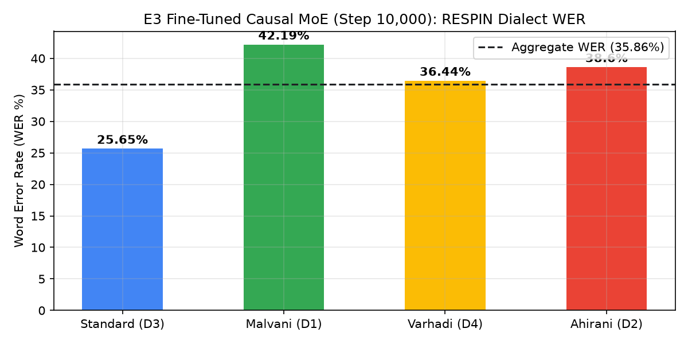

# Real-Time Streaming Marathi ASR (Causal 130M Sparse MoE Conformer)

A strictly causal, chunked real-time Automatic Speech Recognition (ASR) system for Marathi and its regional dialects (**Malvani, Ahirani, Standard Marathi, and Varhadi**), built on a 130.8M-parameter Sparse Mixture-of-Experts (MoE) Conformer encoder with incremental streaming state caching.

> **Note on Checkpoints:** All model checkpoints (`*.pt`) are excluded from this repository via `.gitignore` due to size constraints. Full training logs, experiment configurations, and benchmark evaluation outputs are included under `experiments/`.

---

## Architecture Overview

- **Streaming Frontend (`StreamingLogMelFrontEnd`):** 80-bin Log-Mel spectrogram (`n_fft=400`, `hop_length=160`, `center=False`) with residual waveform buffering across chunks for jitter-free causal framing.
- **Causal Subsampling (`CausalConv2dSubsampling4`):** 4× temporal downsampling (100 fps → 25 fps / 40ms frames) with strictly left-only temporal padding and past-frame caching.
- **Causal Conformer Backbone (`CausalConformerEncoder`):**
  - 12 layers, $d_{\text{model}} = 512$, 8 attention heads, `ffn_expansion = 4`, RoPE positional embeddings.
  - **Causal Multi-Head Self-Attention** with bounded K/V caching (`left_context = 128` frames = 5.12s, zero future lookahead).
  - **Causal Conformer Convolution Module** (`kernel_size = 31`, left-only padding with 30-frame depthwise cache, per-frame LayerNorm).
- **Hierarchical Sparse MoE (`SparseMoELayer`, Layers 5–12):**
  - Always-active shared combining FFN trunk + 3 frame-routed regional dialect experts (Malvani, Ahirani, Varhadi) with Switch-style auxiliary load balancing.
  - **130.8M total parameters** (~98.9M active per forward pass).
- **Incremental CTC Decoder (`StreamingCTCDecoder`):** 105-token Devanagari character vocabulary (`data_utils/vocab.json`) preserving CTC collapse state across streaming chunks.

---

## Repository Structure

```text
realtime/
├── configs/
│   ├── base.yaml
│   ├── dataset/             # Evaluation dataset configs
│   ├── model/               # Dense & MoE causal Conformer configs
│   └── experiment/          # E1 causality ablations, E2 distillation, E3 RL & eval configs
├── data_loaders/            # Manifest-based Marathi streaming dataset loader
├── data_utils/              # Devanagari character vocabulary (vocab.json)
├── models/
│   ├── causal_conformer/    # Strictly causal streaming Conformer + MoE + CTC decoder
│   ├── marathi-conformer-130m-dense/  # Offline 130M dense reference architecture
│   └── marathi-conformer-130m-moe/    # Offline 130M MoE teacher reference architecture
├── tasks/
│   ├── run_stage1_pretrain.py   # Stage 1: Causal masked-spectrogram SSL pretraining
│   ├── run_stage2_moe_adapt.py  # Stage 2: Sparse MoE upcycling & dialect adaptation
│   ├── run_stage3_alignment.py  # Stage 3: Multi-source full-sampling CTC alignment
│   ├── run_full_pipeline.py     # End-to-end 3-stage pipeline + evaluation orchestrator
│   ├── rl_distill_loss.py       # Teacher-guided KD + sequence-level GRPO loss engine
│   ├── run_e3_rl_distill.py     # E3 causal distillation & sequence RL trainer
│   ├── run_e3_eval.py           # Full benchmark & 160ms streaming RTF evaluation suite
│   ├── run_experiments.py       # E1 causality & chunk-parity verification suite
│   └── monitor_and_eval.py      # Background monitor & evaluation trigger
├── experiments/
│   ├── pipeline_status.json     # End-to-end pipeline completion ledger
│   ├── stage1_causal_pretrain/  # Stage 1 training logs
│   ├── stage2_causal_moe/       # Stage 2 training logs
│   ├── stage3_final_alignment/  # Stage 3 training logs
│   └── e3_full_eval_suite/      # Benchmark metrics.json, dialect WER plot, eval logs
├── components/                  # Sentinel component specifications
├── sentinel.yaml                # Sentinel workspace configuration
└── SENTINEL.md                  # Experiment tracking & reproducibility protocol
```

---

## 3-Stage Training Pipeline

1. **Stage 1 — Causal SSL Pretraining (`tasks/run_stage1_pretrain.py`):**
   Masked spectrogram reconstruction (`L1 + 0.5 * L2`) on the dense causal Conformer backbone across ~4,191 hours of audio processed (early-stopped at step 80,000).
2. **Stage 2 — Causal Sparse MoE Dialect Adaptation (`tasks/run_stage2_moe_adapt.py`):**
   Function-preserving sparse upcycling of Layers 5–12 FFN2 into the combining trunk and 3 dialect experts, trained in 3 phases (CTC warmup → metadata hard routing → autonomous frame-wise top-1 routing) on speaker-disjoint RESPIN splits (early-stopped at step 170,000; held-out val CER = `3.39%`).
3. **Stage 3 — Multi-Source Final Alignment (`tasks/run_stage3_alignment.py`):**
   Fine-tuning Layers 5–12 + CTC head across the unified multi-source Marathi pool (RESPIN, KathBath Clean/Noisy, OpenSLR64, Common Voice, and transcribed pretraining shards; early-stopped at step 24,000; held-out val CER = `3.38%`).

---

## Benchmark Evaluation Summary (`experiments/e3_full_eval_suite`)

Evaluated under the standardized `mr-norm-1` normalization protocol with greedy character-level CTC decoding (`tasks/run_e3_eval.py`):

| Benchmark | Utterances | Aggregate WER | Aggregate CER | Offline RTF |
|---|---:|---:|---:|---:|
| **IISc RESPIN (Multi-Dialect)** | 2,170 | **35.86%** | **8.84%** | 0.0056 (178.6× RT) |
| — Standard (D3) | 555 | 25.65% | 6.25% | — |
| — Varhadi (D4) | 516 | 36.44% | 9.14% | — |
| — Ahirani (D2) | 540 | 38.60% | 9.14% | — |
| — Malvani (D1) | 559 | 42.19% | 10.66% | — |
| **AI4Bharat KathBath (Marathi)** | 2,378 | **66.71%** | **19.87%** | 0.0015 (666.7× RT) |
| **Google FLEURS (Marathi)** | 1,015 | **62.88%** | **20.64%** | 0.0069 (144.9× RT) |

### Real-Time Chunked Streaming Benchmark
- **Chunk Size:** `160 ms` (zero future lookahead)
- **Streaming RTF:** `0.4063` (**2.5× faster than real-time**)
- **Causality Verification:** Future perturbation prefix diff `< 1e-5` (`1.91e-06`)



---

## Usage

```bash
# Run full 3-stage causal pipeline + benchmark evaluation
python tasks/run_full_pipeline.py

# Run individual stages
python tasks/run_stage1_pretrain.py
python tasks/run_stage2_moe_adapt.py
python tasks/run_stage3_alignment.py

# Run full benchmark & 160ms streaming RTF evaluation
python tasks/run_e3_eval.py --checkpoint <path-to-checkpoint.pt>
```
