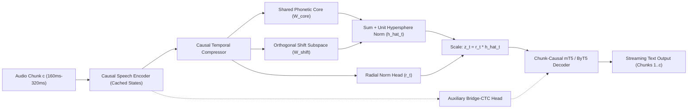

# Spherical Orthogonal Subspace Bridge (SOS-Bridge): Technical Specification

**Document Standard:** ASD-STE100 (Simplified Technical English)  
**Project:** Real-Time Streaming Multilingual ASR with Seq2Seq Decoders  
**Target Output:** Q1 Journal Manuscript (IEEE/ACM TASLP, Computer Speech & Language, Speech Communication, or ACM TALLIP)

---

## 1. Purpose and Scope

This document defines the **Spherical Orthogonal Subspace Bridge (SOS-Bridge)**. The SOS-Bridge connects a causal speech encoder to a modified chunk-causal `mT5` or `ByT5` text decoder.

The design achieves four primary goals:
1. Build a real-time streaming Automatic Speech Recognition (ASR) system with tunable chunk latency (160 ms to 640 ms).
2. Remove cross-language interference across Indo-Aryan dialects and Dravidian languages.
3. Fix the direction-versus-magnitude modality gap between acoustic features and text embeddings.
4. Enable few-shot adaptation to new rural dialects with mathematically bounded forgetting.

---

## 2. Technical Names and Definitions

Use these exact terms across the codebase and manuscript.

| Term / Symbol | Definition |
| :--- | :--- |
| **Causal Speech Encoder** | An acoustic encoder that processes audio chunks with zero future lookahead beyond the current chunk. |
| **SOS-Bridge** | A lightweight neural projection module (3M to 5M parameters) placed between the speech encoder and the text decoder. |
| **$W_{\text{core}}$** | The shared weight matrix that maps universal phonetic features across all languages. |
| **$W_{\text{shift}}$** | The orthogonally constrained weight matrix that captures language-specific and dialect-specific shifts. |
| **Direction–Magnitude Divergence** | The geometric gap where projected speech vectors match text vectors in angle (cosine), but differ in length (L2 norm). |
| **Radial Norm Head ($r_t$)** | A scalar network branch that predicts the L2 norm of each projected acoustic frame. |
| **$\mu_{\text{text}}, \sigma_{\text{text}}$** | The empirical mean and standard deviation of L2 norms from the frozen `mT5`/`ByT5` text encoder. |
| **Chunk-Causal Decoder** | A modified `mT5` or `ByT5` decoder whose cross-attention reads only bridge frames up to the current audio chunk $c$. |
| **`<WAIT>` Token** | A special control token that stops decoder emission for chunk $c$ until chunk $c+1$ arrives. |

---

## 3. Problem Statement

Plain feed-forward network (FFN) bridges fail under multilingual and rural dialect shifts. Two concrete geometric flaws cause this failure.

### 3.1 Flaw 1: Cross-Family and Dialect Interference
A single monolithic FFN mixes universal acoustic mappings with dialect-specific mappings in the same weight space. When the model trains on diverse language families (Indo-Aryan and Dravidian) or regional dialects (Malvani, Ahirani, Varhadi, Bhojpuri, Magahi, Maithili), gradients conflict. High-resource standard languages overwrite low-resource rural dialects.

### 3.2 Flaw 2: Direction–Magnitude Divergence (The Modality Gap)
Recent geometric analyses (2025–2026) show a clear split in speech-to-text bridges:
- Projected speech frames align with text hidden states in **direction** (high cosine similarity).
- Projected speech frames diverge from text hidden states in **magnitude** (large Euclidean and L2-norm error).

The cross-attention layers of a pretrained `mT5` or `ByT5` decoder expect vectors with strict text-encoder norm statistics. Wrong magnitudes distort attention softmax sharpness. As a result, the decoder ignores acoustic input and relies on its standard-language text prior. This behavior causes dialect erasure and hallucinations.

### 3.3 Comparison Against Existing 2024–2026 Bridges

| Bridge Method | Primary Mechanism | Key Limitation Under Rural Multilingual Shifts |
| :--- | :--- | :--- |
| **SLAM-ASR / MEUSLI** (2024–2026) | Single downsampler + plain Linear/MLP | Suffers cross-family interference and norm drift. Targets heavy decoder-only LLMs. |
| **Q-Former** (2024–2025) | Learned cross-attention query bottleneck | Loses strict monotonic timing required for low-latency streaming ASR. |
| **LegoSLM** (2025) | CTC posteriors weighted over LLM vocabulary | Depends on vocabulary alignment and cannot adapt continuous dialect manifolds smoothly. |
| **SMEAR-MoE** (Jan 2026) | Soft-merged Mixture-of-Experts FFN copies | Duplicates full FFN weights per expert and does not correct radial norm divergence. |
| **SOS-Bridge (Ours)** | Orthogonal core/shift FFN + decoupled spherical norm calibration | Compact (3M–5M params), bounds cross-dialect interference, fixes norm drift, and streams natively with Seq2Seq cross-attention. |

---

## 4. End-to-End Streaming Architecture

The system processes incoming audio in fixed streaming chunks $c \in \{1, 2, \dots, C\}$ (160 ms, 320 ms, or 640 ms).



### Data Flow Summary
1. The **Causal Speech Encoder** extracts frame states $X^{(c)} \in \mathbb{R}^{B \times T_c \times d_{\text{enc}}}$ using cached past keys, values, and convolution buffers.
2. The **Causal Temporal Compressor** reduces acoustic frame rate to match text token density.
3. The **SOS-Bridge** transforms compressed frames into calibrated decoder-space states $Z^{(c)} \in \mathbb{R}^{B \times T'_c \times d_{\text{dec}}}$.
4. The **Bridge Cache** appends $Z^{(c)}$ to past states $Z^{(1..c-1)}$.
5. The **Chunk-Causal `mT5`/`ByT5` Decoder** emits tokens for chunk $c$ until it outputs `<WAIT>` or `<EOS>`.

---

## 5. Mathematical Specification of the SOS-Bridge

Let $X \in \mathbb{R}^{B \times T \times d_{\text{enc}}}$ denote the output of the causal speech encoder for a chunk or sequence.

### 5.1 Step 1: Causal Temporal Compression
Apply a strictly causal 1D strided convolution (left-only padding) with stride $s \in \{2, 4\}$:

$$U = \text{SiLU}\!\big(\text{CausalConv1d}_s(X)\big) \in \mathbb{R}^{B \times T' \times d_{\text{enc}}}$$

This step reduces 25 Hz Conformer frames to 6.25 Hz–12.5 Hz. This rate matches subword and character token density in Indic scripts.

### 5.2 Step 2: Orthogonal Subspace Decomposition
Decompose the bridge transformation into a **shared universal phonetic core** and a **low-rank orthogonal shift branch**:

$$H_{\text{core}} = W_{\text{core},2}\,\sigma\!\big(W_{\text{core},1}\,\text{LN}(U)\big)$$

$$H_{\text{shift}} = W_{\text{shift},2}\,\sigma\!\big(W_{\text{shift},1}\,\text{LN}(U)\big)$$

Here:
- $W_{\text{core},1} \in \mathbb{R}^{d_{\text{enc}} \times d_{\text{mid}}}$, $W_{\text{core},2} \in \mathbb{R}^{d_{\text{mid}} \times d_{\text{dec}}}$ capture shared cross-lingual phonetics.
- $W_{\text{shift},1} \in \mathbb{R}^{d_{\text{enc}} \times r_{\text{shift}}}$, $W_{\text{shift},2} \in \mathbb{R}^{r_{\text{shift}} \times d_{\text{dec}}}$ ($r_{\text{shift}} \ll d_{\text{mid}}$, e.g., $r_{\text{shift}} = 128$) capture dialect and language shifts.

Combine both branches with a learnable scalar gate $\alpha_{\text{shift}}$:

$$H = H_{\text{core}} + \tanh(\alpha_{\text{shift}}) \cdot H_{\text{shift}}$$

Enforce strict subspace orthogonality between the output projection bases $W_{\text{core},2}$ and $W_{\text{shift},2}$:

$$\mathcal{L}_{\text{orth}} = \frac{1}{d_{\text{mid}} \cdot r_{\text{shift}}} \left\| \widetilde{W}_{\text{core},2}^\top \widetilde{W}_{\text{shift},2} \right\|_F^2$$

where $\widetilde{W}$ denotes column-normalized matrices.

**Mathematical Guarantee:** Because $\widetilde{W}_{\text{core},2}^\top \widetilde{W}_{\text{shift},2} \approx 0$, updates to $W_{\text{shift}}$ move representations in directions orthogonal to the shared phonetic core. New rural dialects cannot erase shared phonetic knowledge.

### 5.3 Step 3: Decoupled Direction–Magnitude Projection
Separate each projected vector $h_t \in \mathbb{R}^{d_{\text{dec}}}$ into its unit direction and its scalar radius.

1. **Hyperspherical Direction Projection:**
   $$\hat{h}_t = \frac{h_t}{\|h_t\|_2 + \epsilon}$$
   Every frame vector now lies on the unit hypersphere $\mathbb{S}^{d_{\text{dec}} - 1}$.

2. **Calibrated Radial Norm Head:**
   Predict a positive scalar norm $r_t$ directly from the compressed acoustic feature $u_t$:
   $$r_t = \mu_{\text{text}} + \sigma_{\text{text}} \cdot \tanh\!\big(w_r^\top \sigma(W_r\,\text{LN}(u_t))\big)$$
   Alternatively, use a softplus parameterization centered at $\mu_{\text{text}}$:
   $$r_t = \text{Softplus}\!\big(w_r^\top \sigma(W_r\,\text{LN}(u_t)) + b_{\mu}\big)$$
   where $\mu_{\text{text}}$ and $\sigma_{\text{text}}$ are precomputed once from the frozen `mT5`/`ByT5` text encoder over the training transcripts.

3. **Final Calibrated Bridge Output:**
   $$z_t = r_t \cdot \hat{h}_t$$

### 5.4 Parameter Budget
For $d_{\text{enc}} = 512$, $d_{\text{dec}} = 512$ (`mT5-small`), $d_{\text{mid}} = 1024$, and $r_{\text{shift}} = 128$:
- Causal Conv Compressor: ~0.79M parameters
- Shared Core FFN ($W_{\text{core}}$): ~1.05M parameters
- Orthogonal Shift Branch ($W_{\text{shift}}$): ~0.13M parameters
- Radial Norm Head + Norms: ~0.15M parameters
- Auxiliary CTC Head (optional): ~0.10M parameters
- **Total SOS-Bridge Size:** **~2.2M to 4.5M parameters** (less than 5% of total model size).

---

## 6. Modified Chunk-Causal Seq2Seq Decoder

Use either **Indic-Pruned `mT5-small`** or **`ByT5-small`** as the autoregressive decoder.

### 6.1 Indic Vocabulary Pruning for `mT5-small`
Standard `mT5-small` contains 300M parameters. Roughly 256M parameters reside in the 250,112-token multilingual embedding tables.
1. Filter the SentencePiece vocabulary to retain only Devanagari, Bengali, Kannada, Telugu, Latin/English loanwords, digits, and control tokens (~20,000 tokens).
2. Slice the pretrained `shared.weight` and `lm_head.weight` rows for the kept token IDs.
3. Result: Model size drops from **300M to ~65M parameters** with zero loss of Indic pretraining weights.

### 6.2 `ByT5-small` Comparison Track
`ByT5-small` operates directly on UTF-8 bytes (384 vocabulary tokens). It eliminates subword fragmentation across scripts and code-switched rural loanwords. Benchmark both decoders directly with the exact same SOS-Bridge.

### 6.3 Chunk-Causal Monotonic Cross-Attention
Standard `mT5` cross-attention sees all encoder frames $1..T'$. Modify the decoder cross-attention mask for streaming:
1. Segment each training transcript into chunk targets $Y^{(1)}, Y^{(2)}, \dots, Y^{(C)}$ using forced CTC alignments from the causal encoder.
2. Append a `<WAIT>` token to the end of each chunk target $Y^{(c)}$ (except the final chunk, which ends with `<EOS>`).
3. Construct a block-lower-triangular cross-attention mask $M_{\text{cross}}$:
   - Any decoder token belonging to chunk $c$ attends **only** to bridge frames $Z^{(1..c)}$.
   - Future bridge frames $Z^{(c+1..C)}$ receive $-\infty$ mask scores.
4. During streaming inference, decode greedily or with small beam search ($k = 4$) per chunk until `<WAIT>` appears, then hold decoder KV cache and await chunk $c+1$.

---

## 7. Training Objectives and Procedures

### 7.1 Composite Loss Function
Train the model with five cleanly weighted terms:

$$\mathcal{L}_{\text{total}} = \mathcal{L}_{\text{seq2seq}} + \lambda_{\text{ctc}}\,\mathcal{L}_{\text{CTC}} + \lambda_{\text{orth}}\,\mathcal{L}_{\text{orth}} + \lambda_{\text{norm}}\,\mathcal{L}_{\text{norm}} + \lambda_{\text{align}}\,\mathcal{L}_{\text{align}}$$

| Loss Term | Formula / Role | Default Weight |
| :--- | :--- | :---: |
| **$\mathcal{L}_{\text{seq2seq}}$** | Cross-entropy loss on chunk-interleaved `<WAIT>` target tokens from the modified `mT5`/`ByT5` decoder. | `1.0` |
| **$\mathcal{L}_{\text{CTC}}$** | Auxiliary CTC loss on the causal encoder + bridge output to enforce monotonic alignment. | `0.3` |
| **$\mathcal{L}_{\text{orth}}$** | Frobenius orthogonality penalty $\|\widetilde{W}_{\text{core},2}^\top \widetilde{W}_{\text{shift},2}\|_F^2$. | `0.1` |
| **$\mathcal{L}_{\text{norm}}$** | Radial distribution matching: $(\bar{r} - \mu_{\text{text}})^2 + (\text{std}(r) - \sigma_{\text{text}})^2$. | `0.05` |
| **$\mathcal{L}_{\text{align}}$** | Pooled cosine alignment between mean-pooled $Z$ and frozen `mT5`/`ByT5` text encoder states $H_{\text{text}}$. | `0.1` |

### 7.2 Step-by-Step Training Procedure (ASD-STE100)

#### Stage 1: Compute Text-Encoder Target Norm Statistics
1. Load the pretrained `mT5` (or `ByT5`) text encoder in evaluation mode.
2. Pass 10,000 random training transcripts across all target languages through the frozen text encoder.
3. Compute the empirical mean L2 norm $\mu_{\text{text}}$ and standard deviation $\sigma_{\text{text}}$ across non-padding tokens.
4. Save $\mu_{\text{text}}$ and $\sigma_{\text{text}}$ as non-trainable buffers inside the SOS-Bridge.

#### Stage 2: Bridge Alignment Warmup
1. Freeze the causal speech encoder and the pruned `mT5`/`ByT5` decoder.
2. Train **only the SOS-Bridge** for 5,000 to 10,000 steps (`lr = 5e-4`, cosine decay).
3. Monitor cosine similarity and L2 norm gap between $Z$ and frozen text-encoder states on the validation set.

#### Stage 3: Joint Streaming Fine-Tuning
1. Unfreeze upper encoder layers (or apply LoRA to the encoder) and unfreeze the modified chunk-causal decoder (with lower LR, `0.2x` of bridge LR).
2. Train with **Dynamic Chunk Sizes** (randomly sample chunk size from `{160ms, 320ms, 640ms, full}` per batch).
3. Evaluate on a **balanced multi-domain validation set** (do not use a single-corpus validation slice).

#### Stage 4: Few-Shot Adaptation to a New Rural Dialect or Language
1. Freeze the speech encoder, the decoder, and **$W_{\text{core}}$**.
2. Unfreeze **only $W_{\text{shift}}$** (~0.13M to 0.5M parameters) and the radial norm head.
3. Fine-tune on 1 hour to 5 hours of the new rural dialect or language.
4. Measure WER on the new dialect AND measure zero-regression WER on all prior languages.

---

## 8. Reference PyTorch Implementation

```python
import torch
import torch.nn as nn
import torch.nn.functional as F


class CausalConvDownsampler(nn.Module):
    """Strictly causal 1D strided temporal compressor with streaming cache support."""

    def __init__(self, dim: int, kernel_size: int = 5, stride: int = 2):
        super().__init__()
        self.kernel_size = kernel_size
        self.stride = stride
        self.pad_len = kernel_size - 1
        self.conv = nn.Conv1d(dim, dim, kernel_size=kernel_size, stride=stride, padding=0)
        self.act = nn.SiLU()

    def forward(self, x: torch.Tensor, cache: torch.Tensor | None = None):
        # x: (B, T, D)
        x_t = x.transpose(1, 2)  # (B, D, T)
        if cache is not None:
            x_in = torch.cat([cache, x_t], dim=2)
        else:
            x_in = F.pad(x_t, (self.pad_len, 0))
        new_cache = x_in[:, :, -self.pad_len:].detach()
        out = self.act(self.conv(x_in)).transpose(1, 2)  # (B, T', D)
        return out, new_cache


class SOSBridge(nn.Module):
    """
    Spherical Orthogonal Subspace Bridge (SOS-Bridge).
    Combines:
      1. Causal temporal downsampling
      2. Orthogonal Core + Low-Rank Shift FFN decomposition
      3. Hyperspherical direction projection + calibrated radial norm head
    """

    def __init__(
        self,
        enc_dim: int = 512,
        dec_dim: int = 512,
        core_hidden: int = 1024,
        shift_rank: int = 128,
        downsample_stride: int = 2,
        target_norm_mean: float = 12.0,
        target_norm_std: float = 2.0,
        dropout: float = 0.1,
    ):
        super().__init__()
        self.compressor = CausalConvDownsampler(enc_dim, kernel_size=5, stride=downsample_stride)
        self.in_norm = nn.LayerNorm(enc_dim)

        # 1. Shared universal phonetic core FFN
        self.core_w1 = nn.Linear(enc_dim, core_hidden)
        self.core_w2 = nn.Linear(core_hidden, dec_dim, bias=False)

        # 2. Orthogonal low-rank language/dialect shift FFN
        self.shift_w1 = nn.Linear(enc_dim, shift_rank)
        self.shift_w2 = nn.Linear(shift_rank, dec_dim, bias=False)
        self.shift_gate = nn.Parameter(torch.tensor(0.0))

        # 3. Calibrated radial norm predictor
        self.norm_head = nn.Sequential(
            nn.Linear(enc_dim, 128),
            nn.SiLU(),
            nn.Linear(128, 1),
        )
        self.register_buffer("mu_text", torch.tensor(float(target_norm_mean)))
        self.register_buffer("sigma_text", torch.tensor(float(target_norm_std)))

        self.dropout = nn.Dropout(dropout)

    def orthogonality_loss(self) -> torch.Tensor:
        """Enforce W_core^T @ W_shift = 0 on output projection bases."""
        # Linear weights have shape (dec_dim, hidden) -> columns are basis vectors in R^{dec_dim}
        wc = F.normalize(self.core_w2.weight, dim=0)   # (dec_dim, core_hidden)
        ws = F.normalize(self.shift_w2.weight, dim=0)  # (dec_dim, shift_rank)
        gram = torch.matmul(wc.transpose(0, 1), ws)    # (core_hidden, shift_rank)
        return (gram ** 2).mean()

    def radial_calibration_loss(self, radii: torch.Tensor, mask: torch.Tensor | None = None) -> torch.Tensor:
        """Match predicted radial norm mean and std to frozen mT5/ByT5 text encoder."""
        r = radii.squeeze(-1)
        if mask is not None:
            r = r[mask.bool()]
        if r.numel() < 2:
            return r.new_tensor(0.0)
        mean_loss = (r.mean() - self.mu_text) ** 2
        std_loss = (r.std(unbiased=False) - self.sigma_text) ** 2
        return mean_loss + std_loss

    def forward(
        self,
        enc_hidden: torch.Tensor,
        conv_cache: torch.Tensor | None = None,
    ):
        # Step 1: Causal temporal compression
        u, new_cache = self.compressor(enc_hidden, cache=conv_cache)
        u_norm = self.in_norm(u)

        # Step 2: Orthogonal subspace FFN
        h_core = self.core_w2(self.dropout(F.gelu(self.core_w1(u_norm))))
        h_shift = self.shift_w2(self.dropout(F.gelu(self.shift_w1(u_norm))))
        h = h_core + torch.tanh(self.shift_gate) * h_shift

        # Step 3: Decoupled direction (unit hypersphere) + calibrated radial magnitude
        h_dir = F.normalize(h, p=2, dim=-1, eps=1e-6)
        delta_r = torch.tanh(self.norm_head(u_norm))  # Bounded deviation in [-1, 1]
        radii = torch.clamp(self.mu_text + 2.0 * self.sigma_text * delta_r, min=1e-3)
        z = radii * h_dir

        return {
            "bridge_states": z,
            "radii": radii,
            "direction": h_dir,
            "conv_cache": new_cache,
            "orth_loss": self.orthogonality_loss(),
        }
```

---

## 9. Journal Evaluation Protocol

To satisfy reviewers at **IEEE/ACM TASLP** or **Computer Speech & Language**, execute this exact evaluation matrix.

### 9.1 Datasets (Multilingual and Dialect Shifts)
1. **Marathi Multi-Dialect Shift:** IISc RESPIN Marathi (D1 Malvani, D2 Ahirani, D3 Standard, D4 Varhadi) + OOD KathBath Marathi + OOD FLEURS Marathi.
2. **Pan-Indic Cross-Script and Cross-Family Shift:** All 9 IISc RESPIN languages (`mr, hi, bh, ch, mg, mt, bn, kn, te`) spanning 4 scripts (Devanagari, Bengali, Kannada, Telugu) and 2 language families (Indo-Aryan and Dravidian).
3. **Few-Shot Shift Benchmark:** Hold out 2 low-resource languages/dialects (for example, Bhojpuri + Maithili, or Ahirani + Kannada). Freeze all weights except $W_{\text{shift}}$ and adapt on 1 hr and 5 hrs of speech.

### 9.2 Controlled Baselines (Swap Only the Bridge)
Keep the causal speech encoder and chunk-causal decoder fixed. Compare six bridges fairly:
1. **Causal CTC Baseline** (no Seq2Seq decoder — current Stage 3 benchmark)
2. **Plain FFN Bridge** (`SLAM-ASR` / `MEUSLI` baseline)
3. **Q-Former Bridge**
4. **LegoSLM CTC-Posterior Bridge** (2025)
5. **SMEAR-MoE Bridge** (Jan 2026)
6. **SOS-Bridge (Ours)** — evaluated with both **Indic-Pruned `mT5-small`** and **`ByT5-small`**

Include offline reference models (Offline 130M MoE, Offline IndicConformer-600M, Offline Whisper-large-v3) as non-streaming upper bounds.

### 9.3 Required Ablations and Diagnostic Proofs
1. **Component Ablation Table:**
   - Remove orthogonality penalty ($\lambda_{\text{orth}} = 0$)
   - Remove decoupled spherical direction–magnitude head (standard linear output)
   - Remove radial calibration loss ($\lambda_{\text{norm}} = 0$)
   - Remove text-encoder pooled alignment ($\lambda_{\text{align}} = 0$)
   - Compare `Indic-Pruned mT5-small` vs. `ByT5-small`
2. **Geometric Proof Figure (Critical for Reviewers):**
   Plot layer-wise **Cosine Similarity** AND **L2 Norm Ratio** ($\|z_t\|_2 / \|h_{\text{text}}\|_2$) for Plain FFN vs. SMEAR-MoE vs. SOS-Bridge. Demonstrate directly that SOS-Bridge closes the magnitude divergence gap.
3. **Interference Proof Figure:**
   Plot **Forgetting Delta** ($\Delta\text{WER}$ on seen languages) vs. **Adaptation Gain** ($\Delta\text{WER}$ on a new held-out rural dialect) when adapting Plain FFN vs. SMEAR-MoE vs. SOS-Bridge ($W_{\text{shift}}$ only).
4. **Streaming Latency–Accuracy Pareto Curve:**
   Plot WER vs. chunk latency (`160 ms`, `320 ms`, `640 ms`, `Offline`) alongside **Streaming RTF** and **Average Lagging (AL)**.
5. **Statistical Significance:**
   Report speaker-cluster 95% bootstrap confidence intervals and MAPSSWE p-values across all dialect and language slices.

---

## 10. Two-Phase Execution Checklist

### Phase 1: Fast Marathi Proof-of-Concept (Days 1–5)
1. Prune `mT5-small` vocabulary to Devanagari + Latin (~12k–20k tokens) and compute $\mu_{\text{text}}, \sigma_{\text{text}}$.
2. Build chunk-causal cross-attention wrapper and `<WAIT>` CTC-aligned batch collator.
3. Attach `SOSBridge` to your Causal Conformer encoder and train on balanced Marathi (RESPIN + KathBath + OpenSLR + CommonVoice + IndicVoices).
4. Run head-to-head comparison: `Causal CTC` vs. `Plain FFN` vs. `SMEAR-MoE` vs. `SOS-Bridge` on RESPIN D1–D4, KathBath, and FLEURS.
5. Verify two go/no-go gates:
   - Streaming WER improves strongly over pure causal CTC (`35.86%` RESPIN, `66.71%` KathBath).
   - `SOS-Bridge` beats `Plain FFN` and matches or beats `SMEAR-MoE` with fewer parameters and cleaner norm geometry.

### Phase 2: Multilingual Shift Suite for Journal Submission (Days 6–14)
1. Swap in a multilingual causal speech encoder (chunked Whisper / MMS / IndicConformer encoder) alongside your Conformer.
2. Train and evaluate across the 9 RESPIN Indic languages (Indo-Aryan + Dravidian).
3. Run the few-shot $W_{\text{shift}}$-only adaptation experiment on held-out rural languages/dialects.
4. Generate all diagnostic plots (Norm Drift, Forgetting vs. Adaptation, Latency–WER Pareto) and bootstrap significance tables.
5. Draft the manuscript for **Computer Speech & Language** or **IEEE/ACM TASLP**.
